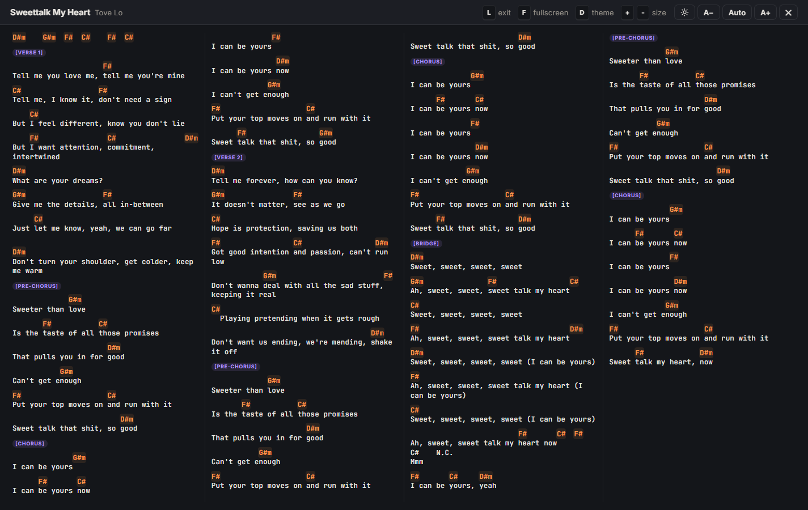
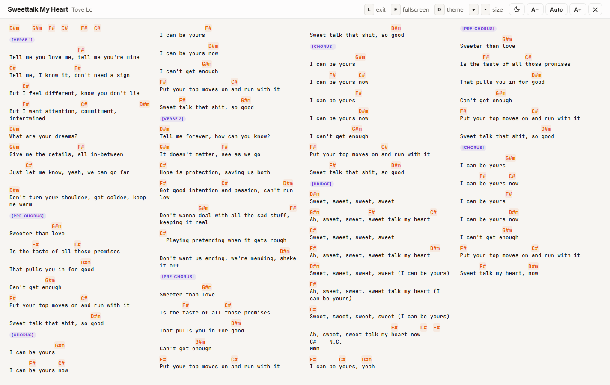

 **English** &nbsp;·&nbsp; <a href="language/README.pt-BR.md"> Português (Brasil)</a>

# Cifra Club Unlocked · Userscript Extension

A small userscript that makes [Cifra Club](https://www.cifraclub.com.br) nicer to play from.

- **Whole song on one screen:** press `L` and the song fits in auto-sized columns, no scrolling
- **Split columns without the ad:** "Dividir em colunas" turns on right away
- **Page-turner pedal without the ad:** "Pedal passador" opens right away (needs a free login)
- **Light/dark switch:** press `D` to switch the site and the full-screen view together

| Dark | Light |
|---|---|
|  |  |

No more of this:


## Install

1. Install a userscript manager: [Tampermonkey](https://www.tampermonkey.net/) or [Violentmonkey](https://violentmonkey.github.io/). On Firefox, [Violentmonkey](https://addons.mozilla.org/firefox/addon/violentmonkey/) is the recommended one.

   ⚠️ **On Chrome or Edge: right-click the extension's icon → Manage extension → turn on Allow User Scripts.**
2. Click here: **[Install the script](https://raw.githubusercontent.com/gkp1/cifra-club-unlocked-userscript-extension/main/cifraclub-unlocked.user.js)**. Your userscript manager opens an install page; click **Install**.
3. Open any song or reload the Cifra Club page. An orange "Press L" banner shows up above the chords.

Updates arrive automatically through your userscript manager.

## Shortcuts

| Key | What it does | Where |
|---|---|---|
| `L` | Open / close the full-screen view | song pages |
| `D` | Light / dark theme | anywhere on the site |
| `F` | Browser fullscreen | full-screen view |
| `+` / `-` | Bigger / smaller text | full-screen view |
| `0` | Back to automatic size | full-screen view |
| `Esc` | Close the full-screen view | full-screen view |

The buttons and hints follow your browser's language: Portuguese if your browser is in Portuguese, English otherwise.

## Settings

Open the script in your userscript manager and change the lines at the top:

```js
const KEY_VIEW = 'l';        // toggles the one-screen view
const KEY_BROWSER_FS = 'f';  // browser fullscreen (inside the view)
const KEY_THEME = 'd';       // light/dark theme (site and view)
const START_ON = false;      // open songs in the one-screen view? (then remembers your last choice)
const UNLOCK = true;         // unlock "Dividir em colunas" and "Pedal passador" without the ad
```

## How the unlock works

When you watch the ad, Cifra Club stores a 24-hour pass in a cookie in your browser. The script writes that same cookie and renews it when it expires, so the site sees the feature as already unlocked. That's all it does:

- Everything happens in your browser and nothing is sent anywhere. The only thing the script downloads is the fonts for the full-screen view (Inter and JetBrains Mono, from Google Fonts).
- It doesn't touch your account, doesn't log in for you, and doesn't pretend you're a subscriber.
- Features that Cifra Club checks on its servers stay as they are.

If Cifra Club changes how this works, the unlock may stop working until the script is updated. [Open an issue](https://github.com/gkp1/cifra-club-unlocked-userscript-extension/issues) if you notice that.

## Notes

- Unofficial project, not affiliated with Cifra Club or Studio Sol.
- If you use Cifra Club a lot, consider supporting it with [Cifra Club PRO](https://www.cifraclub.com.br/assine/).

## License

[MIT](LICENSE)
