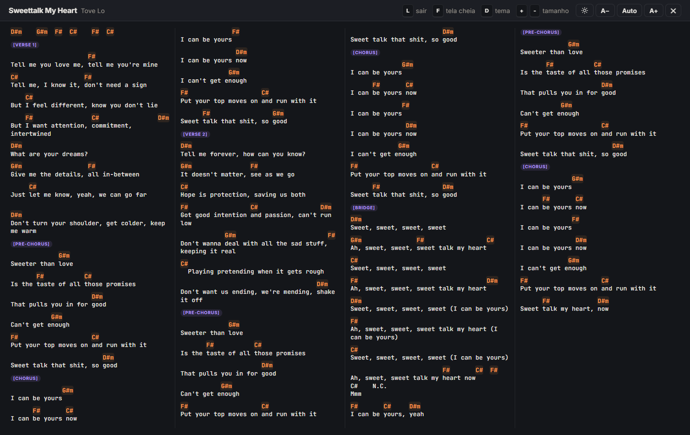
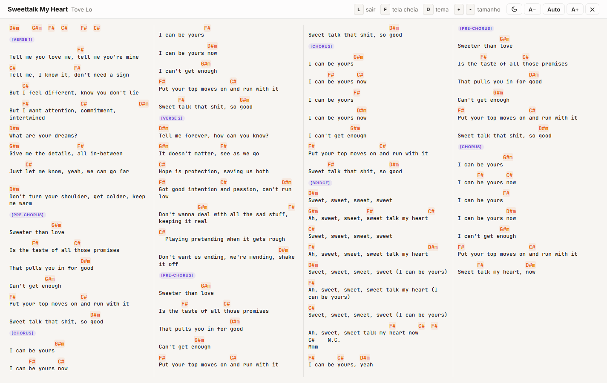
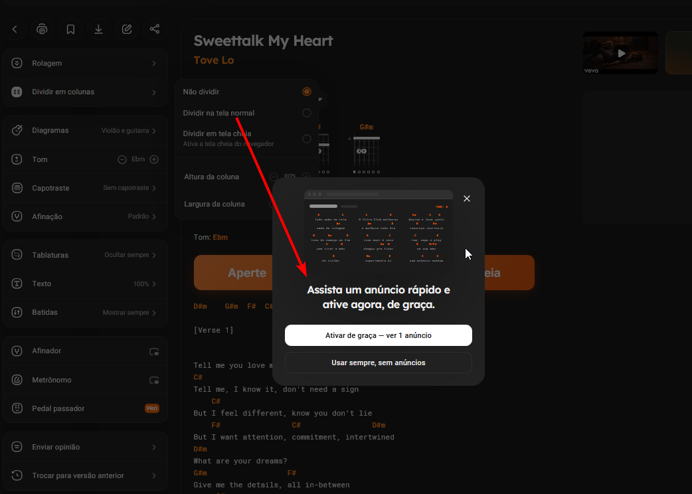

<a href="../README.md"> English</a> &nbsp;·&nbsp;  **Português (Brasil)**

# Cifras Desbloqueadas: Ultimate Guitar + Cifra Club · Userscript Extensão

[](https://discord.gg/rtVf2zyM8c)

Um userscript pequeno e grátis que deixa o [Ultimate Guitar](https://tabs.ultimate-guitar.com) e o [Cifra Club](https://www.cifraclub.com.br) melhores pra tocar. Três coisas que ele faz em qualquer música, nos dois sites:

1. **Mudar o tom, fácil e de graça:** `[` `]` sobem ou descem meio tom, na página ou no modo tela cheia. No Ultimate Guitar funciona em todas as páginas de cifra e de tablatura, até nas tablaturas que não têm botão de tom. Os acordes ficam em cima das palavras certas.
2. **Liga/desliga tablaturas, com detecção inteligente de acordes:** `T` esconde ou mostra as tablaturas. O script separa sozinho acordes, letra, tablatura e nomes das partes, mesmo nas tablaturas que não marcam os acordes.
3. **Modo tela cheia:** aperte `L` e a música inteira cabe numa tela só, em colunas com fonte automática, sem rolagem.

| Escuro | Claro |
|---|---|
|  |  |

**E mais**
- **Ultimate Guitar:** os espaços de anúncio e o popup de cadastro ("Sign up") somem
- **Cifra Club:** "Dividir em colunas" e "Pedal passador" abrem sem anúncio (o pedal precisa de login grátis)
- **Tom e capo à vista:** o modo mostra o tom atual, mesmo depois de mudar, e o capotraste (e a afinação no Ultimate Guitar)
- **Impressão e tema:** `P` imprime a cifra inteira numa página, `D` troca o tema claro/escuro (no Cifra Club, o site e o modo juntos)
- **Feito pra tocar:** a tela não apaga com o modo aberto, e o tamanho do texto fica salvo pra cada música

Chega disso no Cifra Club:



## Instalação

1. Instale o Tampermonkey ou o Violentmonkey, os gerenciadores de userscripts recomendados:
   - **Tampermonkey:**  [Chrome](https://chromewebstore.google.com/detail/tampermonkey/dhdgffkkebhmkfjojejmpbldmpobfkfo) &nbsp;·&nbsp;  [Firefox](https://addons.mozilla.org/firefox/addon/tampermonkey/)
   - **Violentmonkey:**  [Chrome](https://chromewebstore.google.com/detail/violentmonkey/jinjaccalgkegednnccohejagnlnfdag) &nbsp;·&nbsp;  [Firefox](https://addons.mozilla.org/firefox/addon/violentmonkey/)

   ⚠️ **No Chrome ou Edge: clique com o botão direito no ícone da extensão → Gerenciar extensão → ative Permitir scripts de usuário (Allow User Scripts).**
2. Clique aqui: **[Instalar o script](https://raw.githubusercontent.com/gkp1/cifra-club-unlocked-userscript-extension/main/cifraclub-unlocked.user.js)**. O gerenciador abre uma página de instalação; clique em **Instalar**.
3. Abra qualquer cifra no Ultimate Guitar ou no Cifra Club, ou recarregue a página. Uma faixa laranja "Aperte L" aparece acima da cifra.

As atualizações chegam sozinhas pelo gerenciador.

## Atalhos

| Tecla | O que faz | Onde |
|---|---|---|
| `L` | Abre / fecha o modo tela cheia | páginas de cifra |
| `[` / `]` | Meio tom abaixo / acima | páginas de cifra e modo tela cheia (nas tablaturas do Ultimate Guitar sem botão de tom, só no modo) |
| `D` | Tema claro / escuro | em todo o Cifra Club, no modo tela cheia no Ultimate Guitar |
| `T` | Mostra / esconde as tablaturas | modo tela cheia, músicas com tablatura |
| `P` | Imprime ou salva em PDF, numa página | modo tela cheia |
| `F` | Tela cheia do navegador | modo tela cheia |
| `+` / `-` | Aumenta / diminui o texto | modo tela cheia |
| `0` | Volta ao tamanho automático | modo tela cheia |
| `Esc` | Fecha o modo tela cheia | modo tela cheia |

Cada botão mostra a sua tecla. Os botões e dicas seguem o idioma do navegador: português se o navegador estiver em português, inglês nos outros casos.

## Configurações

Abra o script no gerenciador e mude as linhas do bloco Config, perto do topo:

```js
const START_ON = false; // abrir já no modo tela cheia? (depois lembra a última escolha)
const UNLOCK = true;    // Cifra Club: colunas e pedal sem anúncio. Ultimate Guitar: esconde anúncios e o popup de cadastro
```

## Como o desbloqueio funciona

**Cifra Club:** quando você assiste o anúncio, o Cifra Club guarda um passe de 24 horas num cookie no seu navegador. O script grava esse mesmo cookie e renova quando ele vence, então o site já considera o recurso liberado.

**Ultimate Guitar:** o script esconde os espaços de anúncio e o popup de cadastro na sua tela. Quando a página não tem botão de tom, ele muda os acordes no modo tela cheia sozinho.

É só isso:

- Tudo acontece no seu navegador. O script não baixa nada e não envia nada pra lugar nenhum.
- Não mexe na sua conta, não faz login por você e não finge que você é assinante.
- Recursos que os sites conferem no servidor continuam como estão. As tablaturas Official e Pro do Ultimate Guitar continuam bloqueadas, e o script fica desligado nessas páginas.

Se algum dos sites mudar esse funcionamento, o script pode parar de funcionar nele até ser atualizado. [Abra uma issue](https://github.com/gkp1/cifra-club-unlocked-userscript-extension/issues) se perceber isso.

## Observações

- Projeto não oficial, sem ligação com o Cifra Club, a Studio Sol ou o Ultimate Guitar.
- Se você usa muito esses sites, considere apoiar com o [Cifra Club PRO](https://www.cifraclub.com.br/assine/) ou o Ultimate Guitar Pro.

## Licença

[MIT](../LICENSE)
